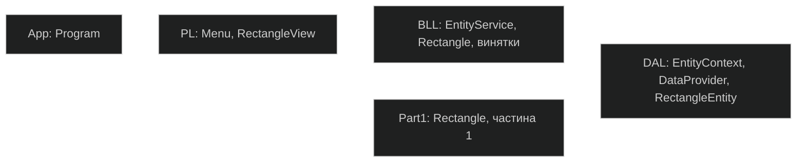
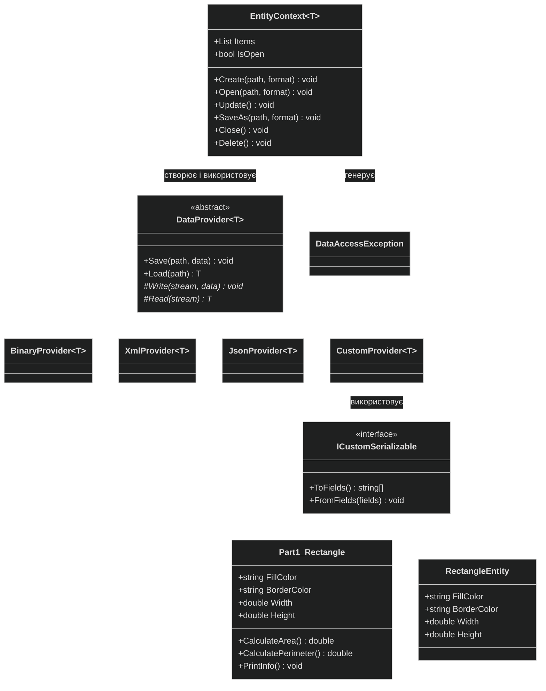
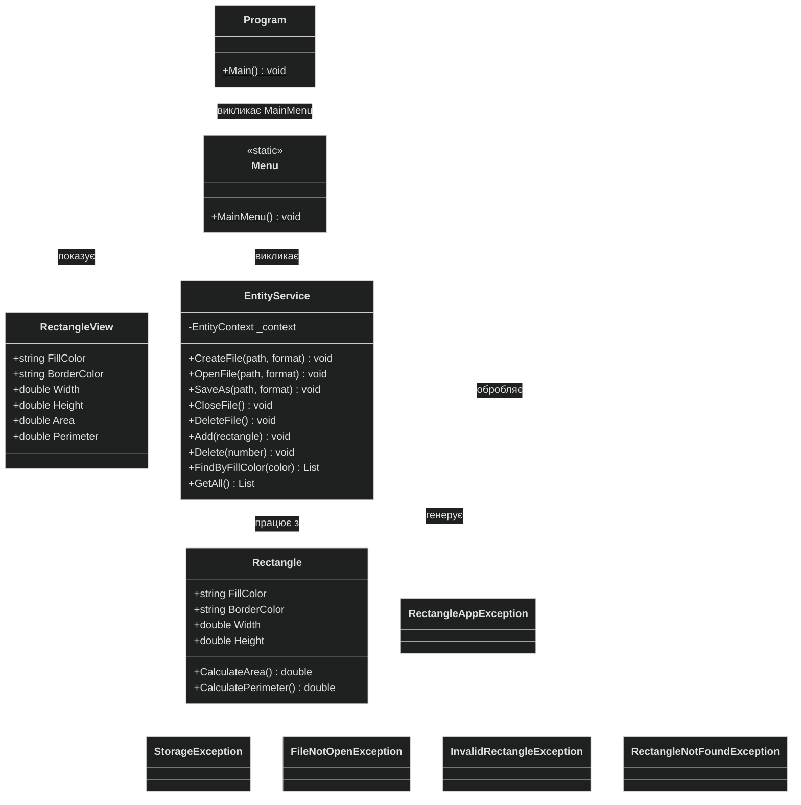

# Діаграма класів проєкту lab3_oop

Лабораторна робота 3.3, варіант 5.

Щоб побачити діаграми у VS Code, встановіть розширення **Markdown Preview Mermaid Support** і натисніть `Ctrl+Shift+V`.

## Залежності між проєктами

## Частина 1 і рівень DAL

## Рівні BLL і PL

## Позначення

| Запис | Значення |
|---|---|
| `+` | Відкритий член класу (`public`) |
| `-` | Закритий член класу (`private`) |
| `#` | Захищений член класу (`protected`) |
| Курсив | Абстрактний метод |
| Підкреслення | Статичний метод |
| Суцільна стрілка з порожнім трикутником | Успадкування |
| Пунктирна стрілка з порожнім трикутником | Реалізація інтерфейсу |
| Суцільна стрілка | Клас зберігає посилання на інший клас |
| Пунктирна стрілка | Клас використовує інший клас |

`Part1_Rectangle` на діаграмі - це клас `Rectangle` із проєкту `Part1`. На діаграмі BLL клас `Rectangle` - це модель рівня BLL.
