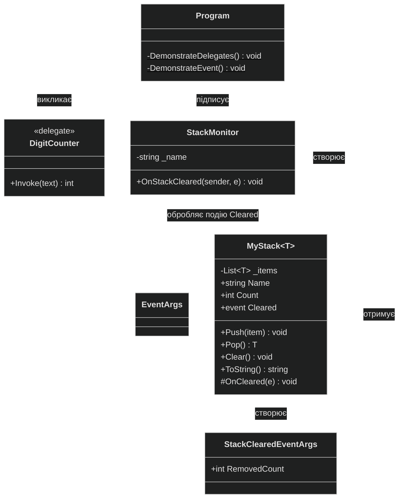

# Діаграма класів проєкту lab4_oop

Лабораторна робота 3.4, варіант 5.

Щоб побачити діаграму у VS Code, встановіть розширення **Markdown Preview Mermaid Support** і натисніть `Ctrl+Shift+V`.

## Позначення

| Запис | Значення |
|---|---|
| `+` | Відкритий член класу (`public`) |
| `-` | Закритий член класу (`private`) |
| `#` | Захищений член класу (`protected`) |
| Підкреслення | Статичний метод |
| Суцільна стрілка з порожнім трикутником | Успадкування |
| Пунктирна стрілка | Клас використовує інший клас |

`EventArgs` - стандартний клас .NET. Подія `Cleared` має тип `EventHandler<StackClearedEventArgs>`.

У коді `DemonstrateDelegates` і `DemonstrateEvent` записані в `Program.cs` на верхньому рівні, без явного оголошення класу. Клас `Program` для них створює компілятор.
