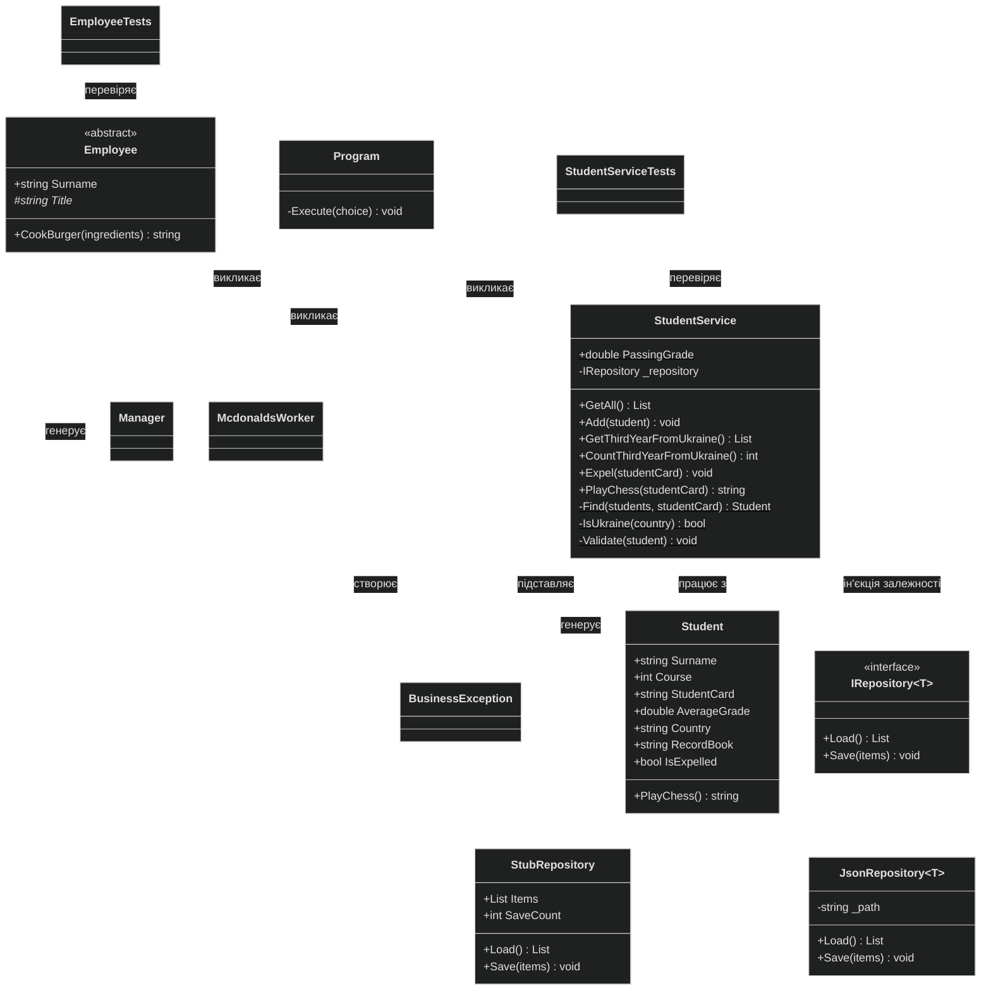

# Діаграма класів проєкту lab5_oop

Лабораторна робота 3.5, варіант 5.

Щоб побачити діаграму у VS Code, встановіть розширення **Markdown Preview Mermaid Support** і натисніть `Ctrl+Shift+V`.

## Розташування класів

| Файл | Рівень | Класи |
|---|---|---|
| `lab5_oop\PL.cs` | Представлення | Код меню. Клас `Program` для нього створює компілятор |
| `lab5_oop\BLL.cs` | Бізнес-логіка | `BusinessException`, `Student`, `Employee`, `McdonaldsWorker`, `Manager`, `StudentService` |
| `lab5_oop\DAL.cs` | Доступ до даних | `IRepository<T>`, `JsonRepository<T>` |
| `lab5_oop.Tests\Tests.cs` | Модульні тести | `StubRepository`, `StudentServiceTests`, `EmployeeTests` |

## Позначення

| Запис | Значення |
|---|---|
| `+` | Відкритий член класу (`public`) |
| `-` | Закритий член класу (`private`) |
| `#` | Захищений член класу (`protected`) |
| Курсив | Абстрактний член класу |
| Підкреслення | Статичний член класу |
| Суцільна стрілка з порожнім трикутником | Успадкування |
| Пунктирна стрілка з порожнім трикутником | Реалізація інтерфейсу |
| Суцільна стрілка | Клас зберігає посилання на інший клас |
| Пунктирна стрілка | Клас використовує інший клас |
